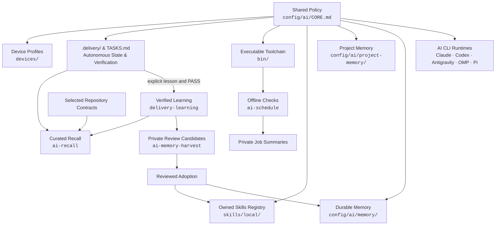

# Dotfiles Sitemap & Engineering Dictionary

> The development dictionary for `ongkipro/dotfiles`: every tracked page, what
> it is for, and who owns it. Reviewed: 2026-10-25. Review the hand-written
> notes twice a year; `system-map --check` enforces everything derivable.

**Use it.** Ask, don't scan: `system-map --find <terms>` ranks this page and the
indexes it federates ([project memory](../config/ai/project-memory/MEMORY.md),
[Kelola memory](../config/ai/project-memory-kelola/MEMORY.md),
[skills](../skills/local/README.md)); add `--json` for agents. Otherwise start at
**Quick find**, then the numbered sections.

**Change it.** Link every new tracked file here as a list item: the link, a
colon, then what it is for, in the words its source uses. `--check` fails
on an unlinked member, an entry without a note, a stale inventory, or a broken
link.

**Contents:** [Quick find](#quick-find) ·
[1 Topology](#1-system-topology-overview) ·
[2 Index](#2-sitemap-directory-index) ·
[3 AI kernel](#3-core-policy--ai-kernel-configai) ·
[4 Durable memory](#4-durable-memory-dictionary-configaimemory) ·
[5 Project memory](#5-project-memory-knowledge-base-configaiproject-memory) ·
[6 Skills](#6-owned-skills-directory-skillslocal) ·
[7 Commands](#7-executable-toolchain-dictionary-bin) ·
[8 Devices](#8-multi-device-hardware-registry-devices) ·
[9 Docs](#9-architecture--governance-docs-docs) ·
[10 Templates](#10-project-scaffolding-templates-configtemplates) ·
[11 Environment](#11-environment-and-bootstrap) ·
[12 Reliability](#12-reliability-recovery-and-limits)

---

## Quick find

Each line answers one question with the page that owns it.

- [Change a rule every AI CLI follows](../config/ai/CORE.md): approval gates, language, code discipline, Git rules; edit here, never a rendered context.
- [Change behavior for one runtime only](../config/ai/adapters/claude.md): runtime adapters (Claude here; Codex, agy, OMP, Pi beside it) rendered by `ai-memory-link`.
- [Why a memory file loaded, or make one load](../config/ai/memory-router.json): trigger routing with byte and file budgets; test with [`ai-memory-route`](../bin/ai-memory-route).
- [Find a project's reference card](../config/ai/project-memory/MEMORY.md): the one index of project memory.
- [Find which skill owns a domain](../skills/local/README.md): rendered domain map of owned skills (`skill-map`).
- [Add, update, or expose a skill](../skills/agents-bin/skill-update): links `skills/local` into every runtime; check with [`skill-check`](../skills/agents-bin/skill-check).
- [See what is queued or next](../TASKS.md): the sole executable task queue and its contracts.
- [Know the current state](../STATUS.md): status authority; memory never overrides it.
- [Start, scope, or finish a task run](../docs/task-change-boundary.md): ledger boundary contract enforced by [`delivery-ledger`](../bin/delivery-ledger).
- [Rate the risk of a diff](../bin/diff-risk): R0 to R4 tiers that decide review depth.
- [Run every policy check before a commit](../bin/ai-policy-lint): policy, routing, skills, memory, templates, and this map.
- [Install dotfiles on a new machine](../install.sh): idempotent installer for Ubuntu and macOS; [`install-macos.sh`](../install-macos.sh) is the light macOS bootstrap.
- [Check this device's AI setup](../bin/ai-doctor): links, tools, hooks, and environment health.
- [Record a verified lesson](../bin/ai-learn): capture and promote reusable lessons; never unverified diagnosis.
- [Start a new project with contracts](../bin/project-init): scaffolds from [`config/templates/`](../config/templates) without overwriting.
- [Decide where a PRD, plan, or ADR goes](../config/ai/policies/planning-artifacts.md): planning-artifact policy; one document per purpose.
- [Ask another AI CLI for a second opinion](../bin/ai-ask): one read-only lane to claude, codex, agy, pi, or omp.
- [Install or check Git safety hooks](../bin/ai-hooks-install): wires [`git-guard.sh`](../config/ai/hooks/git-guard.sh) and memory-usage hooks.
- [Sync MCP servers across runtimes](../bin/ai-mcp-sync): one global MCP list, checked per runtime.
- [Gate a production deploy](../bin/production-gate): safety verification before anything live.
- [Understand learning, recall, and scheduled checks](../docs/adaptive-ai-system.md): how verified lessons, recall, and offline jobs fit together.
- [Update this map](../bin/system-map): renders the inventory, gates coverage, answers `--find`; design sources in [system-map references](research/system-map-references-2026-10-25.md).

---

## 1. System Topology Overview

The `dotfiles` repository shares developer configuration, AI policy, owned skills, and verified tooling across Linux and macOS. Native adapters connect **Claude Code**, **Codex**, **Antigravity `agy`**, **OMP**, and **Pi**; each runtime keeps ownership of its execution and provider configuration.

---

### Architecture invariants

Rules that hold by absence; the code rarely states them.

- Memory never owns status, requirements, or decisions; repository contracts and checks do.
- Owned skills live only in `skills/local/`; runtimes see them through links.
- Rendered files (`config/ai/context/*`, `skills/local/README.md`, this page's inventory) are never edited by hand.
- `delivery-ledger` is the only writer of `.delivery/`; a run never resets, stashes, or commits.
- Each collection has one index; no second list of the same members exists.
- Recall and harvest are advisory: they cite and propose, never apply canonical changes.
- Each runtime keeps its own execution and provider configuration; the shared core only sets policy.
- Canonical hooks are wired for Claude Code and Codex; Codex also requires trust of the exact definitions. Antigravity, Pi, and OMP rely on policy text.

### Inventory

Counts and completeness are checked, not remembered: `bin/system-map --check`
runs in `ai-policy-lint`. Only tracked files count, so after adding a file run
`git add` (or `git add -N`), link it here, then `bin/system-map`.

<!-- system-map:inventory:start (rendered by bin/system-map; do not edit) -->

| Collection | Path | Tracked | Completeness enforced by |
|---|---|---|---|
| Durable memory | [`config/ai/memory/`](../config/ai/memory/) | 21 | linked from this page |
| Project memory | [`config/ai/project-memory/`](../config/ai/project-memory/) | 82 | [`MEMORY.md`](../config/ai/project-memory/MEMORY.md) |
| Kelola memory | [`config/ai/project-memory-kelola/`](../config/ai/project-memory-kelola/) | 17 | [`MEMORY.md`](../config/ai/project-memory-kelola/MEMORY.md) |
| Owned skills | [`skills/local/`](../skills/local/) | 76 | linked from this page |
| Commands | [`bin/`](../bin/) | 58 | linked from this page |
| Command tests | [`bin/`](../bin/) | 73 | linked from this page |
| Device profiles | [`devices/`](../devices/) | 8 | linked from this page |
| Project templates | [`config/templates/`](../config/templates/) | 10 | linked from this page |
| Top-level docs | [`docs/`](../docs/) | 23 | linked from this page |
| AI control files | [`config/ai/`](../config/ai/) | 30 | linked from this page |
| Runtime references | [`config/omp/`](../config/omp/) | 28 | linked from this page |
| Skill commands | [`skills/agents-bin/`](../skills/agents-bin/) | 7 | linked from this page |
| Skill tooling | [`skills/local/`](../skills/local/) | 2 | linked from this page |
| Registry indexes | [`devices/`](../devices/) | 1 | linked from this page |
| Command helpers | [`bin/`](../bin/) | 6 | linked from this page |
| Research records | [`docs/research/`](../docs/research/) | 4 | linked from this page |
| Environment and bootstrap | [`config/`](../config/) | 35 | linked from this page |
| Device reports | [`docs/device-reports/`](../docs/device-reports/) | 21 | count only |
| Archived task records | [`docs/archive/`](../docs/archive/) | 31 | count only |

<!-- system-map:inventory:end -->

---

## 2. Sitemap Directory Index

| Section | Directory / File | Description & Function | Target Audience / Consumer |
|---|---|---|---|
| **Core Kernel** | [`config/ai/CORE.md`](../config/ai/CORE.md) | Canonical cross-CLI operating rules, approval gates, coding standards. | All AI CLIs & Developers |
| **CLI Adapters** | [`config/ai/adapters/`](../config/ai/adapters) | Runtime-specific context adapters (`claude`, `codex`, `antigravity`, `omp`, `pi`). | AI CLI Runtimes |
| **Durable Memory** | [`config/ai/memory/`](../config/ai/memory) | Cross-session, durable operational facts. | `ai-memory-access`, AI sessions |
| **Project Memory** | [`config/ai/project-memory/`](../config/ai/project-memory) | Project reference documents indexed by [`MEMORY.md`](../config/ai/project-memory/MEMORY.md); a file count is not a count of client systems. | On-demand context retrieval |
| **Kelola Memory** | [`config/ai/project-memory-kelola/`](../config/ai/project-memory-kelola) | Specialized knowledge pack for Kelola HRIS infrastructure. | Kelola deployment & maintenance |
| **Skills Registry** | [`skills/local/`](../skills/local) | Owned skills categorized into engineering domains; domain map in [`skills/local/README.md`](../skills/local/README.md). | AI CLI tool calling & workflows |
| **Skill Management**| [`skills/agents-bin/`](../skills/agents-bin) | CLI tools for managing, checking, updating, and removing skills. | Developers & AI toolchain |
| **Executable CLI**  | [`bin/`](../bin) | Bash, Python, and Node.js commands, tests, and helpers for verification and automation. | Terminal workflow & CI |
| **Runtime References** | [`config/omp/`](../config/omp), [`config/pi/`](../config/pi) | OMP references are never installed automatically. Pi settings, model template, and extension may be seeded by the explicit `DOTFILES_SETUP_PI=1` installer option. | OMP and Pi runtimes |
| **Device Registry** | [`devices/`](../devices) | Hardware manifests, OS specs, and per-machine configurations. | `dotsync`, `device-register` |
| **Project Templates** | [`config/templates/`](../config/templates) | Contract scaffold for new projects (`PRD`, `TASKS`, `ARCHITECTURE`, etc.). | `project-init` |
| **System Docs**     | [`docs/`](../docs) | Architecture blueprints, security policies, install SOPs, audit logs. | Architecture & Governance |
| **Delivery Engine** | [`.delivery/`](../.delivery) | Run ledger, verification checkpoints, task boundary states. | `delivery-ledger` |
| **Active Tasks**    | [`TASKS.md`](../TASKS.md) | Single executable task queue for dotfiles evolution. | All contributors & AI agents |
| **User Environment**| [`home/`](../home), [`config/`](../config) | Shell, terminal, editor, Git, and toolchain settings (section 11). | Terminal-first developer setup |
| **CI** | [`.github/workflows/`](../.github/workflows) | Core runtime and spec-suite checks on Ubuntu and macOS. | Every push |

---

## 3. Core Policy & AI Kernel (`config/ai/`)

Central repository for AI behavior, context distribution, and safety guards.

### 3.1 Policy & Context Files
- [`config/ai/CORE.md`](../config/ai/CORE.md) *(formerly `AGENTS.md`)*:
  **Function:** Canonical system prompt & operating contract for all AI models.
  **Features:** Operating profile (Paduka Ongki), language rules (Indonesian conversation, English code/docs), approval gates (secrets, destructive actions, production deploys), lazy senior dev ladder, delivery ledger constraints.
- [`config/ai/README.md`](../config/ai/README.md):
  **Function:** Overview of the shared AI context architecture and memory link paths.
- [`config/ai/memory-router.json`](../config/ai/memory-router.json):
  **Function:** Prompt/path-trigger mapping with file and byte budgets (`maxFiles: 3`, `maxBytes: 12000`).
- [`config/ai/memory-hygiene.json`](../config/ai/memory-hygiene.json):
  **Function:** Memory budget, scope, privacy-marker, stale-claim, authority, and duplicate/conflict rules; link and secret checks have separate owners.
- [`config/ai/claude-hooks.json`](../config/ai/claude-hooks.json):
  **Function:** Canonical Claude Code hook declarations, adapted for Codex by `ai-hooks-install`: `PreToolUse` git-guard, `UserPromptSubmit` memory-usage, and `SessionStart` session-restore.
- [`config/ai/claude-home-memory/MEMORY.md`](../config/ai/claude-home-memory/MEMORY.md):
  **Function:** Read-only bootstrap for Claude sessions started at `$HOME` to prevent accidental auto-memory clutter in dotfiles.

- [`config/ai/AGENTS.md`](../config/ai/AGENTS.md): Symlink to `CORE.md` kept for tools that look for the old name.
- [`config/ai/mcp-servers.json`](../config/ai/mcp-servers.json): The one global MCP server list that `ai-mcp-sync` writes into each runtime.
- [`config/ai/runtime-commands.txt`](../config/ai/runtime-commands.txt): Canonical commands every installer links into `~/.local/bin`, one per line.
- [`config/ai/policies/planning-artifacts.md`](../config/ai/policies/planning-artifacts.md): Where PRD, PLAN, TASKS, ADR, and spec-suite documents live; never a rival beside an existing one.

- **Rendered runtime contexts (never edit):** [`claude.md`](../config/ai/context/claude.md), [`codex.md`](../config/ai/context/codex.md), [`antigravity.md`](../config/ai/context/antigravity.md), [`omp.md`](../config/ai/context/omp.md), [`pi.md`](../config/ai/context/pi.md): `ai-memory-link` renders CORE plus each adapter here; edit the sources instead.

### 3.2 AI Runtimes Adapters (`config/ai/adapters/`)
- [`config/ai/adapters/antigravity.md`](../config/ai/adapters/antigravity.md): Adapter for Antigravity (`agy`).
- [`config/ai/adapters/claude.md`](../config/ai/adapters/claude.md): Adapter for Claude Code (`~/.claude/CLAUDE.md`).
- [`config/ai/adapters/codex.md`](../config/ai/adapters/codex.md): Adapter for OpenAI Codex CLI (`~/.codex/AGENTS.md`).
- [`config/ai/adapters/omp.md`](../config/ai/adapters/omp.md): Adapter for OMP user context (`~/.omp/agent/AGENTS.md`).
- [`config/ai/adapters/pi.md`](../config/ai/adapters/pi.md): Adapter for Pi CLI via `pi()` shell wrapper.

### 3.3 Security & Telemetry Hooks (`config/ai/hooks/`)
- [`config/ai/hooks/git-guard.sh`](../config/ai/hooks/git-guard.sh):
  **Function:** Inspects recognized shell Git invocations. Denies force flags and amend; requests approval for forced refspecs and remote deletion, which Codex converts to denial. Interpreter wrappers and aliases remain outside its parser coverage.
- [`config/ai/hooks/memory-usage.sh`](../config/ai/hooks/memory-usage.sh):
  **Function:** `UserPromptSubmit` hook that records selected memory paths and byte sizes without logging prompts. Selection does not prove a model opened or benefited from a file.

---
- [`config/ai/hooks/git-guard.test.sh`](../config/ai/hooks/git-guard.test.sh): Regression check for `git-guard.sh`; run after touching the guard.
- [`config/ai/hooks/session-restore.sh`](../config/ai/hooks/session-restore.sh): Injects a bounded repository-state brief after compact/resume; `STATUS.md`, `TASKS.md`, and delivery evidence must be rechecked.
- [`config/ai/hooks/session-restore.test.sh`](../config/ai/hooks/session-restore.test.sh): Sandboxed regression check for the session-restore hook.

### 3.4 Evaluation Fixtures (`config/ai/evals/`)
- [`workflow-scenarios.json`](../config/ai/evals/workflow-scenarios.json): Decision-eval scenarios graded by `ai-workflow-eval`.
- **Local execution fixture:** [`README.md`](../config/ai/evals/execution/README.md), [`app.py`](../config/ai/evals/execution/app.py), [`index.html`](../config/ai/evals/execution/index.html), [`browser.mjs`](../config/ai/evals/execution/browser.mjs): synthetic loopback app an agent repairs during execution evals; fake sessions, never production auth.

### 3.5 Runtime References (`config/omp/`, `config/pi/`)
OMP runs upstream-native; installers link none of these files.
- [`config/omp/README.md`](../config/omp/README.md): How OMP uses its own config, what dotfiles still provides, and how to repair drift.
- [`config/omp/config.yml`](../config/omp/config.yml): Secret-free cross-device reference config, used only when passed with `omp --config`.
- [`9router-compat.yml`](../config/omp/9router-compat.yml): Secret-free `modelOverrides` reference for Claude models behind 9router (chat-compatible transport, reasoning efforts); never installed or auto-loaded.
- **OMP records:** [`STATUS.md`](../config/omp/STATUS.md), [`BUILD-LOG.md`](../config/omp/BUILD-LOG.md), [`PERFORMANCE.md`](../config/omp/PERFORMANCE.md), [`GOAL-ORCHESTRATION.md`](../config/omp/GOAL-ORCHESTRATION.md): integration status, build log, performance review, and the on-demand goal-orchestration playbook.
- **OMP historical design evidence:** [`ROUTING.md`](../config/omp/ROUTING.md), [`models.yml`](../config/omp/models.yml): retired custom routing and model catalog; not installed or injected.
- **OMP reference agents (not installed):** [`architect`](../config/omp/agents/architect.md), [`complex-developer`](../config/omp/agents/complex-developer.md), [`debugger`](../config/omp/agents/debugger.md), [`designer`](../config/omp/agents/designer.md), [`librarian`](../config/omp/agents/librarian.md), [`reviewer`](../config/omp/agents/reviewer.md), [`scout`](../config/omp/agents/scout.md), [`security-reviewer`](../config/omp/agents/security-reviewer.md), [`writer`](../config/omp/agents/writer.md): role definitions kept as design evidence.
- **OMP retired overlays:** [`9router-hosted`](../config/omp/overlays/9router-hosted.yml), [`antigravity-hosted`](../config/omp/overlays/antigravity-hosted.yml), [`antigravity-only`](../config/omp/overlays/antigravity-only.yml), [`codex-only`](../config/omp/overlays/codex-only.yml), [`minimax-hosted`](../config/omp/overlays/minimax-hosted.yml): single-provider session overlays; revalidate before selecting one.
- [`config/pi/README.md`](../config/pi/README.md): Optional Pi setup; Pi is a standalone fallback CLI, not an OMP prerequisite.
- **Pi files:** [`settings.json`](../config/pi/settings.json), [`models.template.json`](../config/pi/models.template.json), [`compact-free/index.mjs`](../config/pi/extensions/compact-free/index.mjs), [`compact-free/package.json`](../config/pi/extensions/compact-free/package.json): non-secret defaults copied by `pi-9router-restore`, the machine-local model template, and the custom compaction extension.

## 4. Durable Memory Dictionary (`config/ai/memory/`)

Cross-project durable facts loaded selectively on demand by `ai-memory-access`.

| Page / File | Purpose & Main Knowledge Content |
|---|---|
| [`identity.md`](../config/ai/memory/identity.md) | Persona, tone, honorifics (Paduka Ongki), Indonesian chat style, English technical output. |
| [`preferences.md`](../config/ai/memory/preferences.md) | Terminal-first preferences: Helix (`hx`), Bash, Mise, lazygit, formatting, diff conventions. |
| [`goals.md`](../config/ai/memory/goals.md) | High-level engineering roadmap, business objectives, milestones. |
| [`business.md`](../config/ai/memory/business.md) | Business landscape: client systems, dropshipping, affiliate platforms, e-commerce stores. |
| [`development.md`](../config/ai/memory/development.md) | House stack (Postgres + Drizzle + Better Auth, Astro, Next.js, Cloudflare Workers), lazy developer guidelines. |
| [`development-lessons.md`](../config/ai/memory/development-lessons.md) | Verified cross-project engineering lessons promoted via `ai-learn`. |
| [`workflow.md`](../config/ai/memory/workflow.md) | Pre-dev staging contract (`~/Documents/work/prd/<slug>/` -> `~/Projects/<slug>/`), delivery ledger lifecycle. |
| [`decisions.md`](../config/ai/memory/decisions.md) | Advisory cross-project decisions, preferences, and working assumptions; each project's repository owns its technical decision records. |
| [`skills.md`](../config/ai/memory/skills.md) | The user's skill profile (development, marketing, SEO, affiliate) for calibrating explanation depth, plus where the owned skill set is mapped. |
| [`meta-ads.md`](../config/ai/memory/meta-ads.md) | On-demand Meta Ads knowledge map: algorithm sources, campaign decisions, Indonesia priors, ROAS economics and reviewed private-to-shared learning. |
| [`shopify.md`](../config/ai/memory/shopify.md) | Shopify standards: Dawn baseline, Storefront API, Hydrogen, no CTA in descriptions, brand-generic SEO. |
| [`environment.md`](../config/ai/memory/environment.md) | Hardware & software toolchains, installed packages, mise plugins, cross-platform parity. |
| [`environment-ai-runtimes.md`](../config/ai/memory/environment-ai-runtimes.md) | OMP, optional Pi, 9Router, and Antigravity: availability, credential boundary, and the official install method. |
| [`environment-devices-git.md`](../config/ai/memory/environment-devices-git.md) | User machines, the generated device registry, and the one Git identity shared by all devices. |
| [`projects.md`](../config/ai/memory/projects.md) | Master directory index of active repositories under `~/Projects/`. |
| [`projects-platforms.md`](../config/ai/memory/projects-platforms.md) | Advisory map of product platforms and admin applications (volumecms, adsbookcms); load only for the named platform. |
| [`projects-sites.md`](../config/ai/memory/projects-sites.md) | Historical reference for sites and commerce projects (Astro, Shopify Storefront), SEO knowledge, and repository history. |
| [`long-task-system.md`](../config/ai/memory/long-task-system.md) | Architecture for multi-hour autonomous tasks, state persistence, error boundaries. |
| [`long-task-efficiency.md`](../config/ai/memory/long-task-efficiency.md) | Token economics, context pruning, prompt compaction strategies. |
| [`long-task-security.md`](../config/ai/memory/long-task-security.md) | Security constraints during autonomous runs, preventing file creep and accidental leaks. |
| [`long-task-debugging.md`](../config/ai/memory/long-task-debugging.md) | Investigation playbooks, isolated reproduction techniques, root cause analysis. |

---

## 5. Project Memory Knowledge Base (`config/ai/project-memory/`)

Project-specific references and platform gotchas; [`MEMORY.md`](../config/ai/project-memory/MEMORY.md) is the complete index and the sections below are curated highlights.

### 5.1 Project & Business Reference Cards
- [`MEMORY.md`](../config/ai/project-memory/MEMORY.md): The central index for all project memories.
- **TokoΦ (Commerce SaaS):** [`tokophi.md`](../config/ai/project-memory/tokophi.md), [`tokophi-project.md`](../config/ai/project-memory/tokophi-project.md), [`tokophi-market-and-hosting.md`](../config/ai/project-memory/tokophi-market-and-hosting.md), [`tokophi-deploy-workflow.md`](../config/ai/project-memory/tokophi-deploy-workflow.md), [`tokophi-worktree-deploy-gotchas.md`](../config/ai/project-memory/tokophi-worktree-deploy-gotchas.md), [`tokophi-domain-status.md`](../config/ai/project-memory/tokophi-domain-status.md), [`tokophi-repo-private-ruling.md`](../config/ai/project-memory/tokophi-repo-private-ruling.md), [`tokophi-provider-brand-hidden.md`](../config/ai/project-memory/tokophi-provider-brand-hidden.md).
- **Logistics & Payment Integrations:** [`kiriminaja-integration.md`](../config/ai/project-memory/kiriminaja-integration.md), [`autolaris-payment-integration.md`](../config/ai/project-memory/autolaris-payment-integration.md), [`mengantar-documentation.md`](../config/ai/project-memory/mengantar-documentation.md), [`mengantar-docs-project.md`](../config/ai/project-memory/mengantar-docs-project.md), [`formalinads-malaysia-gateway.md`](../config/ai/project-memory/formalinads-malaysia-gateway.md).
- **Shopify & Storefronts:** [`pixsgo-shopify-store.md`](../config/ai/project-memory/pixsgo-shopify-store.md), [`pixsgo-rebrand-play-and-go.md`](../config/ai/project-memory/pixsgo-rebrand-play-and-go.md), [`pixsgo-categories-from-producttype.md`](../config/ai/project-memory/pixsgo-categories-from-producttype.md), [`pixsgo-layout-width.md`](../config/ai/project-memory/pixsgo-layout-width.md), [`petcue-shopify-site.md`](../config/ai/project-memory/petcue-shopify-site.md), [`petcue-dawn-rebuild.md`](../config/ai/project-memory/petcue-dawn-rebuild.md), [`mystore10-furniture-shopify.md`](../config/ai/project-memory/mystore10-furniture-shopify.md), [`sf-theme-shopify-store.md`](../config/ai/project-memory/sf-theme-shopify-store.md), [`shopify-dev-repo-map.md`](../config/ai/project-memory/shopify-dev-repo-map.md), [`hydrogen-theme-project.md`](../config/ai/project-memory/hydrogen-theme-project.md), [`revenleather-shopify-hk-payments.md`](../config/ai/project-memory/revenleather-shopify-hk-payments.md), [`revenleather-catalog-data.md`](../config/ai/project-memory/revenleather-catalog-data.md).
- **Client & Marketing Sites:** [`dealerhinoofficial.md`](../config/ai/project-memory/dealerhinoofficial.md), [`dealerhinoofficial-project.md`](../config/ai/project-memory/dealerhinoofficial-project.md), [`dealertrukhino.md`](../config/ai/project-memory/dealertrukhino.md), [`aussie-sawit-malaysia.md`](../config/ai/project-memory/aussie-sawit-malaysia.md), [`petanisejahtera.md`](../config/ai/project-memory/petanisejahtera.md), [`petanisejahtera-project.md`](../config/ai/project-memory/petanisejahtera-project.md), [`rtqalhadi-project.md`](../config/ai/project-memory/rtqalhadi-project.md), [`panna-coffee-work-project.md`](../config/ai/project-memory/panna-coffee-work-project.md), [`ongki-pro-site.md`](../config/ai/project-memory/ongki-pro-site.md), [`kamus-project.md`](../config/ai/project-memory/kamus-project.md), [`kamus-almanak.md`](../config/ai/project-memory/kamus-almanak.md), [`travelos.md`](../config/ai/project-memory/travelos.md), [`formalin.md`](../config/ai/project-memory/formalin.md), [`formalin-volumx-project.md`](../config/ai/project-memory/formalin-volumx-project.md), [`jasawebsite-co-brand.md`](../config/ai/project-memory/jasawebsite-co-brand.md).

### 5.2 Engineering Rules & Tooling Gotchas
- [`git-identity-noreply.md`](../config/ai/project-memory/git-identity-noreply.md): Enforces noreply GitHub email for commits.
- [`no-ai-commit-trailer.md`](../config/ai/project-memory/no-ai-commit-trailer.md): Forbids AI attribution trailers (`Co-Authored-By`).
- [`additive-commits-no-history-rewrite.md`](../config/ai/project-memory/additive-commits-no-history-rewrite.md): Prohibition on force-pushes and history mutation.
- [`prefer-git-worktree.md`](../config/ai/project-memory/prefer-git-worktree.md): Mandatory use of git worktree for feature isolation.
- [`worktrunk-worktree-tooling.md`](../config/ai/project-memory/worktrunk-worktree-tooling.md): Configuration for `worktrunk` (`wt`).
- [`skills-vs-memory-boundary.md`](../config/ai/project-memory/skills-vs-memory-boundary.md): Distinction between repository truth, personal memory, and skills.
- [`skill-plumbing.md`](../config/ai/project-memory/skill-plumbing.md): Link mechanics for discovery in Claude, Codex, OMP, Antigravity.
- [`dev-toolchain-mise.md`](../config/ai/project-memory/dev-toolchain-mise.md): Mise runtime management without sudo.
- [`playwright-browser-setup.md`](../config/ai/project-memory/playwright-browser-setup.md): Playwright & headless browser testing guidelines.
- [`cloudflare-pages-direct-upload-lock.md`](../config/ai/project-memory/cloudflare-pages-direct-upload-lock.md): Direct Upload vs Git integration rules.
- [`coolify-vps-dev.md`](../config/ai/project-memory/coolify-vps-dev.md): Self-hosted Coolify VPS rules, SSH keys, password recovery.
- [`antigravity-cli-agy.md`](../config/ai/project-memory/antigravity-cli-agy.md): Rules for `agy` binary and avoiding `@google/gemini-cli`.

### 5.3 Specialized Pack: Kelola HRIS (`config/ai/project-memory-kelola/`)
Comprehensive project memory for the production deployment of `kelolatim.com`:
- [`MEMORY.md`](../config/ai/project-memory-kelola/MEMORY.md): Index of Kelola operational files.
- [`reference_deploy.md`](../config/ai/project-memory-kelola/reference_deploy.md): Production PM2, Nginx, build pipeline.
- [`feedback_deploy_collision.md`](../config/ai/project-memory-kelola/feedback_deploy_collision.md), [`feedback_deploy_nginx_patch.md`](../config/ai/project-memory-kelola/feedback_deploy_nginx_patch.md), [`feedback_npm_install_sandbox.md`](../config/ai/project-memory-kelola/feedback_npm_install_sandbox.md), [`reference_tatacuan_api.md`](../config/ai/project-memory-kelola/reference_tatacuan_api.md), [`reference_telegram_bot_pool.md`](../config/ai/project-memory-kelola/reference_telegram_bot_pool.md): deploy collision, nginx patch and npm sandbox lessons, plus Tatacuan API and Telegram bot pool references.

---

## 6. Owned Skills Directory (`skills/local/`)

Owned capabilities are grouped by domain; `skills/local/README.md` is auto-rendered by `bin/skill-map`. Every runtime accesses these skills via symlinks.

### 6.1 Cloudflare Platform
- [`cloudflare`](../skills/local/cloudflare/SKILL.md): Platform entry point (Workers, KV, D1, R2, Vectorize, WAF).
- [`workers-best-practices`](../skills/local/workers-best-practices/SKILL.md): Production Worker code patterns and anti-patterns.
- [`wrangler`](../skills/local/wrangler/SKILL.md): Cloudflare CLI configuration and bindings.
- [`durable-objects`](../skills/local/durable-objects/SKILL.md): Stateful DO coordination, RPC, SQLite storage, alarms.
- [`agents-sdk`](../skills/local/agents-sdk/SKILL.md): Stateful AI agents and durable workflows on Cloudflare Workers.
- [`cloudflare-email-service`](../skills/local/cloudflare-email-service/SKILL.md): Transactional email sending and routing.
- [`cloudflare-one`](../skills/local/cloudflare-one/SKILL.md): Zero Trust, Tunnels, Access, and Gateway policies.
- [`cloudflare-one-migrations`](../skills/local/cloudflare-one-migrations/SKILL.md): VPN/SWG/SASE migration planning to Cloudflare One.
- [`sandbox-next`](../skills/local/sandbox-next/SKILL.md): Code execution sandbox on `@cloudflare/sandbox@next`.
- [`sandbox-stable`](../skills/local/sandbox-stable/SKILL.md): Stable `@cloudflare/sandbox` execution.
- [`sandbox-migrate-to-next`](../skills/local/sandbox-migrate-to-next/SKILL.md): Migration from `@cloudflare/sandbox` stable to `@next`.

### 6.2 Web Frameworks & Interface
- [`astro-development`](../skills/local/astro-development/SKILL.md): Content-focused Astro architecture and hybrid rendering.
- [`nextjs-development`](../skills/local/nextjs-development/SKILL.md): App Router architecture, Server Actions, route handlers.
- [`shadcn-ui`](../skills/local/shadcn-ui/SKILL.md): React component foundation and accessible primitives.
- [`design-taste`](../skills/local/design-taste/SKILL.md): Public frontend visual direction, OKLCH/HSL color scales, multi-brand skinning, explanatory SVG craft, and niche patterns (`contrast.py`, `design-gate.py`).
- [`admin-dashboard`](../skills/local/admin-dashboard/SKILL.md): Information architecture, responsive tables, chart selection, and `@media print` commercial document specs (`dataviz-and-print-specs.md`).
- [`admin-product-ux`](../skills/local/admin-product-ux/SKILL.md): Operator workflows, state machines, progressive onboarding (`First-Use Empty` vs `Filtered-Zero Empty`), and AI/agentic HITL approval contracts.
- [`ui-validation`](../skills/local/ui-validation/SKILL.md): Browser-based verification (Playwright, responsive, dark/light).
- [`web-perf`](../skills/local/web-perf/SKILL.md): Core Web Vitals profiling, Lighthouse optimization.
- [`threejs`](../skills/local/threejs/SKILL.md): 3D WebGL scenes across vanilla JS, Vite, Astro, and React Three Fiber (R3F).

### 6.3 Animation (GSAP)
- [`gsap-core`](../skills/local/gsap-core/SKILL.md): Core tweening, easing, matchMedia.
- [`gsap-timeline`](../skills/local/gsap-timeline/SKILL.md): Sequencing and complex choreographies.
- [`gsap-scrolltrigger`](../skills/local/gsap-scrolltrigger/SKILL.md): Scroll-linked animation and pinning.
- [`gsap-plugins`](../skills/local/gsap-plugins/SKILL.md): Plugin integration (Flip, SplitText, Draggable, ScrollTo).
- [`gsap-react`](../skills/local/gsap-react/SKILL.md): `useGSAP` hook, cleanup, refs management.
- [`gsap-frameworks`](../skills/local/gsap-frameworks/SKILL.md): Vue, Svelte, and non-React animation lifecycles.
- [`gsap-utils`](../skills/local/gsap-utils/SKILL.md): Utility helpers (`clamp`, `mapRange`, `pipe`, `snap`).
- [`gsap-performance`](../skills/local/gsap-performance/SKILL.md): 60fps optimization, avoiding layout thrashing.

### 6.4 Commerce & Shopify
- [`storefront-development`](../skills/local/storefront-development/SKILL.md): Dawn-aligned progressive enhancement storefronts.
- [`storefront-ux`](../skills/local/storefront-ux/SKILL.md): Commerce journeys, variant selection, direct COD funnels, post-purchase RTS-reduction, WhatsApp conversational handoff, and AI shopping advisor states.
- [`headless-shopify`](../skills/local/headless-shopify/SKILL.md): Storefront API architecture and Customer Account API.
- [`hydrogen-development`](../skills/local/hydrogen-development/SKILL.md): Shopify Hydrogen framework and Oxygen runtime.
- [`hydrogen-headless-tracking`](../skills/local/hydrogen-headless-tracking/SKILL.md): Consent-aware analytics and Web Pixels.

### 6.5 Payments, Logistics & Anti-Abuse
- [`autolaris-h2h`](../skills/local/autolaris-h2h/SKILL.md): Indonesian shipping, payment channels, `/submit` orders.
- [`doku-malaysia-integration`](../skills/local/doku-malaysia-integration/SKILL.md): DOKU Global API for Malaysian checkout (FPX, TNG, GrabPay).
- [`mengantar-api`](../skills/local/mengantar-api/SKILL.md): Indonesian 3PL courier aggregator (JNE, SiCepat, COD).
- [`stripe-best-practices`](../skills/local/stripe-best-practices/SKILL.md): Stripe Checkout, Elements, Subscriptions, Webhooks.
- [`turnstile-spin`](../skills/local/turnstile-spin/SKILL.md): Cloudflare Turnstile bot verification implementation.

### 6.6 Data, Auth & API
- [`postgres-drizzle`](../skills/local/postgres-drizzle/SKILL.md): PostgreSQL schema modeling, Drizzle ORM migrations, RLS.
- [`supabase-stack`](../skills/local/supabase-stack/SKILL.md): Full-spectrum Supabase platform & Postgres best practices — Auth (`@supabase/ssr`, Hooks, MFA), RLS + pgTAP testing, Storage (TUS resumable, signed URLs), Realtime Broadcast, Edge Functions, Vectors (`pgvector` + hybrid RRF), Queues (`pgmq`), Cron (`pg_cron` + `pg_net` + Vault), declarative schemas, and Supavisor pooling.
- [`better-auth-security`](../skills/local/better-auth-security/SKILL.md): Better Auth hardening, rate limiting, trusted origins.
- [`openapi-spec`](../skills/local/openapi-spec/SKILL.md): OpenAPI 3.1 REST specification design and validation.
- [`application-security`](../skills/local/application-security/SKILL.md): Threat modeling, tenant isolation, CSRF, XSS, injection prevention.

### 6.7 Advertising Signals
- [`meta-ads-cli`](../skills/local/meta-ads-cli/SKILL.md): Meta Ads CLI operations, scoped performance analysis, and the on-demand Indonesia market baseline via `dotads-meta`. Account registry/reporting and local asset workflows use the runtime guide on demand.
- [`meta-ads-signal-engine`](../skills/local/meta-ads-signal-engine/SKILL.md): Meta Pixel + CAPI outbox, deduplication `event_id`.
- [`meta-ads-scout`](../skills/local/meta-ads-scout/SKILL.md): Competitor ad intelligence via Meta Ad Library.
- [`google-ads-signal-engine`](../skills/local/google-ads-signal-engine/SKILL.md): Google Tag, sGTM, Enhanced Conversions, Consent Mode v2.
- [`tiktok-ads-signal-engine`](../skills/local/tiktok-ads-signal-engine/SKILL.md): TikTok Pixel + Events API v2, Advanced Matching.

### 6.8 SEO, Content & Traffic
- [`seo-website-builder`](../skills/local/seo-website-builder/SKILL.md): Technical SEO, schema/JSON-LD, canonicals, sitemaps.
- [`ai-traffic-os`](../skills/local/ai-traffic-os/SKILL.md): AI answer-engine optimization (AEO/GEO, Perplexity, SearchGPT).
- [`automated-traffic-pipeline`](../skills/local/automated-traffic-pipeline/SKILL.md): Programmatic SEO (pSEO), indexing automation, RSS syndication.
- [`content`](../skills/local/content/SKILL.md): Multi-asset editorial workflows, batching calendars, quality gates.
- [`copywriting`](../skills/local/copywriting/SKILL.md): Conversion copywriting templates, headline formulas, character limits.
- [`volumx-writer`](../skills/local/volumx-writer/SKILL.md): Tone humanization, terminal dialogue improvements.
- [`cms-content`](../skills/local/cms-content/SKILL.md): Client content-editing layer selection and implementation (Astro collections, Keystatic, Payload, Shopify metaobjects).

### 6.9 Planning & Specification
- [`prd-taskbreaker`](../skills/local/prd-taskbreaker/SKILL.md): Transforms features into numbered PRDs and runnable task queues.
- [`development-spec-suite`](../skills/local/development-spec-suite/SKILL.md): Multi-domain enterprise specification packs.
- [`development-kit`](../skills/local/development-kit/SKILL.md): Router mapping tasks, skill-system changes, CLI onboarding, and upstream adoption to specialized skills and lifecycles; `references/reference-map.md` maps professional-kit concerns to existing homes.
- [`adr-record`](../skills/local/adr-record/SKILL.md): Architectural Decision Record generation.
- [`mermaid-diagram`](../skills/local/mermaid-diagram/SKILL.md): Flowcharts, ERDs, sequence diagrams, and architecture graphs.
- [`product-intelligence`](../skills/local/product-intelligence/SKILL.md): Market viability, pricing analysis, and product scope research.
- [`chain-of-thought`](../skills/local/chain-of-thought/SKILL.md): Structured step-by-step problem decomposition and invariant deduction.

### 6.10 Delivery Practice
- [`full-stack-development`](../skills/local/full-stack-development/SKILL.md): Cross-layer end-to-end feature delivery orchestration.
- [`testing-engineering`](../skills/local/testing-engineering/SKILL.md): Unit, integration, and contract test design.
- [`observability-engineering`](../skills/local/observability-engineering/SKILL.md): Telemetry, OpenTelemetry metrics, structured logging.
- [`github-actions`](../skills/local/github-actions/SKILL.md): CI/CD pipeline automation and security hardening.
- [`lean-code-review`](../skills/local/lean-code-review/SKILL.md): Bloat audit, dead code elimination, YAGNI enforcement.
- [`native-first`](../skills/local/native-first/SKILL.md): Platform-native cheatsheets (standard library over dependencies).
- [`continuous-learning`](../skills/local/continuous-learning/SKILL.md): Capturing reusable lessons and promoting memory candidates.
- [`cross-cli`](../skills/local/cross-cli/SKILL.md): Delegating review/research lanes across installed AI CLIs via `ai-ask`.
- [`codebase-navigation`](../skills/local/codebase-navigation/SKILL.md): Cross-file call/dependency tracing and optional Graphify code graphs.
- [`black-magic`](../skills/local/black-magic/SKILL.md): Evidence-first reverse engineering of captures, bundles, binaries, and live apps (vendored from REA); hands findings to the owning specialist.

### 6.11 Infrastructure & Runtime
- [`vercel`](../skills/local/vercel/SKILL.md): Edge deployment, Vercel CLI, environment variable management.
- [`vultr`](../skills/local/vultr/SKILL.md): VPS provisioning and Coolify deployment via `vultr-cli`.
- [`vps-deploy`](../skills/local/vps-deploy/SKILL.md): Ubuntu VPS deployment and operations via Coolify v4 or Docker Compose.
- [`kelola-deploy`](../skills/local/kelola-deploy/SKILL.md): Production server deployment and recovery for Kelola HRIS.

---

## 7. Executable Toolchain Dictionary (`bin/`)

Commands, their tests, and helpers; counts live in the Inventory block and describe repository inventory, not installed software or device readiness.

### 7.1 AI, Policy & Memory Management
- [`ai-doctor`](../bin/ai-doctor) (+ [`test`](../bin/ai-doctor-test)): Read-only health report for AI runtime wiring: links, tools, hooks, environment; never repairs or installs.
- [`ai-policy-lint`](../bin/ai-policy-lint) (+ [`test`](../bin/ai-policy-lint-test)): Structural lint of the tracked AI control plane: workflows, routing, agent frontmatter, skills, memory, templates, and this map.
- [`ai-learn`](../bin/ai-learn) (+ [`test`](../bin/ai-learn-test)): Captures, lists, and promotes reviewed lesson candidates; never ingests session logs.
- [`delivery-learning`](../bin/delivery-learning) (+ [`test`](../bin/delivery-learning-test)): Stages explicit reusable lessons, finalizes verified PASS signals, and supports idempotent candidate retry.
- [`ai-memory-harvest`](../bin/ai-memory-harvest) (+ [`test`](../bin/ai-memory-harvest-test)): Publishes verified lesson signals as private review candidates in the lesson inbox; never applies canonical changes.
- [`ai-recall`](../bin/ai-recall) (+ [`test`](../bin/ai-recall-test)): Refreshes a private SQLite FTS5 index of selected contracts and verified historical evidence, returning advisory source citations.
- [`ai-schedule`](../bin/ai-schedule) (+ [`test`](../bin/ai-schedule-test)): Manages explicit offline `repo-status` and `dotads-validate` jobs, foreground ticks/loop, private history, and isolated failures; no service or real job is installed automatically.
- [`ai-memory-access`](../bin/ai-memory-access) (+ [`test`](../bin/ai-memory-access-test)): Routes a request to the smallest relevant memory files and records privacy-minimal usage telemetry.
- [`ai-memory-check`](../bin/ai-memory-check) (+ [`test`](../bin/ai-memory-check-test)): Verifies markdown links across all memory files.
- [`ai-memory-hygiene`](../bin/ai-memory-hygiene) (+ [`test`](../bin/ai-memory-hygiene-test)): Checks memory budgets, scope, privacy markers, volatile or stale claims, authority conflicts, and duplicate/conflicting content. Routing coverage belongs to `ai-policy-lint`; secret scanning to `security-check`.
- [`ai-memory-lifecycle`](../bin/ai-memory-lifecycle) (+ [`test`](../bin/ai-memory-lifecycle-test)): Analyzes memory access logs to recommend file retention or pruning.
- [`ai-memory-link`](../bin/ai-memory-link) (+ [`test`](../bin/ai-memory-link-test)): Renders and links native contexts; reconciles manifest command links and prunes only dangling repository-owned links, including the first upgrade from older sync code.
- [`ai-memory-route`](../bin/ai-memory-route) (+ [`test`](../bin/ai-memory-route-test)): Selects scoped memory references using prompt/path triggers and file/byte budgets.
- [`ai-skill-evolution`](../bin/ai-skill-evolution) (+ [`test`](../bin/ai-skill-evolution-test)): Reports advisory recurring-pattern candidates for skill improvement; it does not promote or rewrite skills automatically.
- [`ai-hooks-install`](../bin/ai-hooks-install) (+ [`test`](../bin/ai-hooks-install-test)): Installs and checks canonical Claude Code and Codex hooks; native Codex trust remains an interactive runtime step.
- [`ai-mcp-sync`](../bin/ai-mcp-sync) (+ [`test`](../bin/ai-mcp-sync-test)): Synchronizes and checks global MCP servers across AI CLI runtimes.
- [`ai-ask`](../bin/ai-ask) (+ [`test`](../bin/ai-ask-test)): Hands one lane of work to another AI CLI, read-only by default.
- [`ai-health-daily`](../bin/ai-health-daily) (+ [`test`](../bin/ai-health-daily-test)): Daily read-only health report for this device, built from existing checks.
- [`ai-workflow-eval`](../bin/ai-workflow-eval) (+ [`test`](../bin/ai-workflow-eval-test)): Portable decision evals with guidance-read labels, plus an explicit local execution fixture; never certifies model reliability.

### 7.2 Delivery Ledger, Safety Gates & Testing
- [`delivery-ledger`](../bin/delivery-ledger) (+ [`test`](../bin/delivery-ledger-test)): Repository-local run evidence and resume ledger: boundaries, verification, review, and finish; `STATUS.md` stays the state authority.
- [`project-check`](../bin/project-check) (+ [`test`](../bin/project-check-test)): Discovers and runs a repository's own checks: exit 0 verified, 1 failed, 2 unverified; `--changed`, `--full`, `--ui` modes.
- [`diff-risk`](../bin/diff-risk) (+ [`test`](../bin/diff-risk-test)): Classifies code diffs into risk tiers (R0 to R4).
- [`mutation-sweep`](../bin/mutation-sweep) (+ [`test`](../bin/mutation-sweep-test)): Stubs each `bin/<name>` that has a test and reports any test that still passes with its subject gone.
- [`project-init`](../bin/project-init) (+ [`test`](../bin/project-init-test)): Initializes new projects with standard engineering contracts without overwriting.
- [`production-gate`](../bin/production-gate) (+ [`test`](../bin/production-gate-test)): Enforces safety verification before production deployments.
- [`release-check`](../bin/release-check) (+ [`test`](../bin/release-check-test)): Post-deploy verification: every probe in `OBSERVABILITY.md` must succeed for the state in `STATUS.md`.
- [`release-manifest`](../bin/release-manifest) (+ [`test`](../bin/release-manifest-test)): Validates the repository-local `RELEASE.md` (exit 0 valid, 1 invalid, 2 missing evidence).
- [`rollback-check`](../bin/rollback-check) (+ [`test`](../bin/rollback-check-test)): Verifies safety of rollbacks and rollback scripts.
- [`migration-risk`](../bin/migration-risk) (+ [`test`](../bin/migration-risk-test)): Audits database migration scripts for destructive operations.
- [`resume-brief`](../bin/resume-brief) (+ [`test`](../bin/resume-brief-test)): Answers "where am I?" from repository state alone when resuming work.
- [`delivery-benchmark`](../bin/delivery-benchmark) (+ [`test`](../bin/delivery-benchmark-test)): Evidence-driven delivery telemetry and advisory routing comparisons.
- [`delivery-skill-usage`](../bin/delivery-skill-usage) (+ [`test`](../bin/delivery-skill-usage-test)): Immutable skill-attribution evidence for finished delivery runs.
- [`inspect-project`](../bin/inspect-project) (+ [`test`](../bin/inspect-project-test)): Read-only snapshot of the current directory: Git state, project files, and toolchain.
- [`system-map`](../bin/system-map) (+ [`test`](../bin/system-map-test)): Renders this page's inventory and fails lint on unlinked collection members, unindexed project memory, or broken links.

### 7.3 Multi-Device Sync & Credentials
- [`dotsync`](../bin/dotsync) (+ [`test`](../bin/dotsync-test)): Pulls, merges, and reconciles dotfiles cross-device.
- [`dotpush`](../bin/dotpush) (+ [`test`](../bin/dotpush-test)): Commits and pushes dotfiles in one step: syncs with the remote first and scans for secrets before committing.
- [`device-register`](../bin/device-register) (+ [`test`](../bin/device-register-test)): Registers current machine specs into `devices/`.
- [`device-verify`](../bin/device-verify) (+ [`test`](../bin/device-verify-test)): Runs every repository gate on this device and writes a report other devices can read.
- [`dev-ready`](../bin/dev-ready) (+ [`test`](../bin/dev-ready-test)): Read-only readiness summary for runtime wiring, available checks, and ledger state. Reports unknown provider health and existing dirty paths; `delivery-ledger` enforces task-surface overlap.
- [`secrets-env`](../bin/secrets-env) (+ [`test`](../bin/secrets-env-test)): Safely inspects and injects credentials from `~/.config/ai-local/secrets.env`.
- [`security-check`](../bin/security-check) (+ [`test`](../bin/security-check-test)): Audits repositories for staged credentials and secret leaks.

### 7.4 Skill & Runtime Plumbing
- [`skill-map`](../bin/skill-map) (+ [`test`](../bin/skill-map-test)): Compiles the domain map in `skills/local/README.md`.
- [`skill-surface-check`](../bin/skill-surface-check) (+ [`test`](../bin/skill-surface-check-test)): Reports stale dotfiles command references in owned `SKILL.md` files; advisory.
- [`omp-runtime-report`](../bin/omp-runtime-report) (+ [`test`](../bin/omp-runtime-report-test)): Reports native OMP routes and validates their declared registry capabilities.
- [`9router-credential-migrate`](../bin/9router-credential-migrate) (+ [`test`](../bin/9router-credential-migrate-test)): Migrates 9Router API keys securely.
- [`pi-update-safe`](../bin/pi-update-safe) (+ [`test`](../bin/pi-update-safe-test)): Wraps `pi update` with a backup of Pi's runtime skill directories under `~/.pi/agent/skill-backups`.
- [`tmux-setup`](../bin/tmux-setup) (+ [`test`](../bin/tmux-setup-test)): Installs and configures tmux from zero: binary, clipboard tool, `tmux.conf` link, TPM, plugins; idempotent.
- [`tmux-clip`](../bin/tmux-clip) (+ [`test`](../bin/tmux-clip-test)): The clipboard seam every tmux copy path goes through (pbcopy, wl-copy, xclip or xsel, or WSL clip.exe).
- [`tmux-battery`](../bin/tmux-battery) (+ [`test`](../bin/tmux-battery-test)): Battery segment for the tmux status bar; silent and exit 0 on machines without a battery.
- [`vps-pgdump`](../bin/vps-pgdump) (+ [`test`](../bin/vps-pgdump-test)): Pulls a Postgres backup and the stack config off a VPS over SSH, because provider snapshots failed silently.
- [`dotfiles-vultr`](../bin/dotfiles-vultr): `vultr-cli` for the `dotfiles-vultr` account; injects `VULTR_DOTFILES_API_KEY` from `secrets-env` into that one process, so no `~/.vultr-cli.yaml` is needed.
- [`dotfiles-coolify`](../bin/dotfiles-coolify): `coolify` CLI for the `vps-main` instance; the CLI context holds only the URL and the token comes from `secrets-env` (`COOLIFY_VPS_MAIN_TOKEN`) per call.
- [`shopify-content-helper`](../bin/shopify-content-helper) (+ [`test`](../bin/shopify-content-helper-test)): Shopify SEO and content utilities: SEO audit and limits, sitemap entries, meta and brief templates, RSS and JSON-LD skeletons.
- [`dotads-meta`](../bin/dotads-meta) (+ [`test`](../bin/dotads-meta-test)): Per-project Meta Ads campaign validator, dry-run planner, stateful deployer, and `secrets-env` bridge for Meta's official CLI; offline Indonesia market baseline and scoped economics observations. SDK account discovery, scoped inventory/Insights snapshots, immutable Markdown/CSV reports, selected media import and reference-only adoption.
- [`_dotads-meta-provider.py`](../bin/_dotads-meta-provider.py) (+ [`SDK tests`](../bin/_dotads-meta-provider-test.py)): Private read adapter for official-SDK account inventory and Insights; bounded paging, retries and isolated transport tests.
- [`_dotads-workspace.mjs`](../bin/_dotads-workspace.mjs) (+ [`filesystem tests`](../bin/_dotads-workspace-test.mjs)): Private account registry, immutable snapshots/reports, media import and reference-only adoption; filesystem safety and recovery checks.
- [`rea-skill-sync`](../bin/rea-skill-sync) (+ [`test`](../bin/rea-skill-sync-test)): Deterministic upstream auto-sync and drift checker synchronizing `skills/local/black-magic/` with `morluto/rea`.
- [`skill-upstream`](../bin/skill-upstream) (+ [`test`](../bin/skill-upstream-test)): Read-only drift report for skills that declare a watch-only `.upstream` or a vendored source; never edits a skill.
- [`pi-9router-restore`](../bin/pi-9router-restore): Restores optional Pi settings and the device-local 9Router model integration.
- [`pi-9router-sync.js`](../bin/pi-9router-sync.js): Refreshes Pi's existing 9Router providers from their public catalogs in the machine-local `models.json`.

### 7.5 Skill Commands (`skills/agents-bin/`)
- [`skill-help`](../skills/agents-bin/skill-help): Prints the skill commands and the one-source symlink model.
- [`skill-list`](../skills/agents-bin/skill-list): Lists every skill with what it is for.
- [`skill-open`](../skills/agents-bin/skill-open): Opens a skill's `SKILL.md` in the editor.
- [`skill-check`](../skills/agents-bin/skill-check) (+ [`test`](../bin/skill-check-test)): Validates one or all owned skills offline: frontmatter, reference links, and description length against the 1024-character limit and Codex's ~250-character cut.
- [`skill-new`](../skills/agents-bin/skill-new): Creates a skill with a trigger description.
- [`skill-remove`](../skills/agents-bin/skill-remove) (+ [`test`](../bin/skill-remove-test)): Removes a skill from every CLI at once.
- [`skill-update`](../skills/agents-bin/skill-update) (+ [`test`](../bin/skill-update-test)): Installs or repairs the skill symlinks; once per machine.

### 7.6 Helpers and Cross-Cutting Tests
- [`_toolchain-path.sh`](../bin/_toolchain-path.sh) (+ [`test`](../bin/toolchain-path-test)): Sourced, never run: the one definition of where this machine's runtimes are.
- [`_workflow-execution.py`](../bin/_workflow-execution.py): Trusted local behavioral oracle for `ai-workflow-eval`; stdlib only.
- [`delivery-gate-test`](../bin/delivery-gate-test): Exercises `project-check` and delivery gates against fixture projects.
- [`release-safety-test`](../bin/release-safety-test): Covers `release-manifest`, `migration-risk`, and `rollback-check` together.
- [`installer-link-test`](../bin/installer-link-test): Backup-before-link helpers used by the installers.
- [`shell-wrapper-test`](../bin/shell-wrapper-test): Cross-shell setup fixtures and transparent OMP execution.
- **OMP boundary tests:** [`omp-routing-test`](../bin/omp-routing-test), [`omp-effective-routing-test`](../bin/omp-effective-routing-test), [`omp-9router-claude-test`](../bin/omp-9router-claude-test), [`omp-workspace-test`](../bin/omp-workspace-test): dotfiles may add context and skills but never installs routing or alters OMP arguments.
- [`pi-9router-restore-test`](../bin/pi-9router-restore-test): Machine-local Pi seeding and the remote-only 9Router boundary.
- [`memory-usage-hook-test`](../bin/memory-usage-hook-test): Regression check for the `UserPromptSubmit` memory-usage hook.
- [`turnstile-secret-test`](../bin/turnstile-secret-test): Secret handling in the `turnstile-spin` skill scripts.
- [`development-spec-suite-test`](../bin/development-spec-suite-test): Runs the `development-spec-suite` skill's own test script.
- [`_refresh-vendored.sh`](../skills/local/_refresh-vendored.sh) (+ [`test`](../bin/vendored-refresh-test)): Re-fetches vendored skills byte for byte from their `.source`, reports index drift, and preserves managed forks (`.local-fork`).

---

## 8. Multi-Device Hardware Registry (`devices/`)

Managed by `bin/device-register`, documenting exact hardware and OS specs:

- [`devices/README.md`](../devices/README.md): Registry index written by `device-register`.

| Host Profile | Device Hardware | Operating System | Primary Purpose |
|---|---|---|---|
| [`rich.md`](../devices/rich.md) | Dell OptiPlex 7050 (i7-7700T, 32GB RAM) | Ubuntu 24.04 LTS | Heavy workstation, local test runner, long background tasks |
| [`Fantastico.md`](../devices/Fantastico.md) | Lenovo ThinkPad X280 (i7-8650U, 16GB RAM) | Ubuntu 26.04 LTS | Portable Linux dev machine |
| [`cuan.md`](../devices/cuan.md) | Lenovo ThinkPad T480 (i7-8650U, 16GB RAM) | Ubuntu 26.04 LTS | Secondary Linux workstation |
| [`ongkis-MacBook-Air.md`](../devices/ongkis-MacBook-Air.md) | Apple MacBook Air (M1, 8GB RAM) | macOS 26.5 | Paduka Ongki's primary macOS laptop |
| [`irwansyahs-MacBook-Air.md`](../devices/irwansyahs-MacBook-Air.md) | Apple MacBook Air (M4, 16GB RAM) | macOS 26.5 | Irwansyah's primary machine |
| [`feris-MacBook-Air.md`](../devices/feris-MacBook-Air.md) | Apple MacBook Air (M1, 8GB RAM) | macOS 26.5 | Secondary macOS workstation |
| [`Olans-MacBook-Pro.md`](../devices/Olans-MacBook-Pro.md) | Apple MacBook Pro (M2, 8GB RAM) | macOS 26.5 | Secondary macOS workstation |
| [`lenovo.md`](../devices/lenovo.md) | Intel i7-1355U, 7.6 GB RAM | Ubuntu 26.04.1 LTS on WSL2 | Windows-hosted Linux dev environment |

---

## 9. Architecture & Governance Docs (`docs/`)

- [`DOTFILES_AI_ENGINEERING_CONTROL_PLANE.md`](../docs/DOTFILES_AI_ENGINEERING_CONTROL_PLANE.md): Architecture blueprint for multi-provider routing and token economics.
- [`DOTFILES_AI_ENGINEERING_MASTER_BLUEPRINT.md`](../docs/DOTFILES_AI_ENGINEERING_MASTER_BLUEPRINT.md): Unified audit specification and operational roadmap.
- [`task-change-boundary.md`](../docs/task-change-boundary.md): Rules governing task scope, file modifications, and risk boundaries.
- [`ai-memory-sync.md`](../docs/ai-memory-sync.md): Multi-device memory synchronization protocol.
- [`project-init.md`](../docs/project-init.md): Standard repository initialization contract.
- [`repo-visibility.md`](../docs/repo-visibility.md): Public vs private repository security protocol.
- [`shopify-ai-development-repos.md`](../docs/shopify-ai-development-repos.md): Mapping of Shopify open-source repositories and theme tools.
- [`linux-dev-setup.md`](../docs/linux-dev-setup.md) & [`macos-install-step-by-step.md`](../docs/macos-install-step-by-step.md): Clean-install guides for new workstations.
- [`ai-execution-evaluation.md`](../docs/ai-execution-evaluation.md): Local execution evaluation procedure and its evidence limits.
- [`chatgpt-inbox.md`](../docs/chatgpt-inbox.md): Phone capture from a ChatGPT "Dotfiles Inbox" into `ai-learn import`.
- [`linux-install-step-by-step.md`](../docs/linux-install-step-by-step.md): Linux install from zero, step by step.
- [`linux-maintenance-log.md`](../docs/linux-maintenance-log.md): Linux maintenance log.
- [`github-account-cleanup-plan.md`](../docs/github-account-cleanup-plan.md), [`github-profile-readme-draft.md`](../docs/github-profile-readme-draft.md): GitHub account cleanup plan and profile README draft.
- Dated audits (historical, superseded by current contracts): [`DOTFILES_AI_ENGINEERING_AUDIT_2026-08-14.md`](../docs/DOTFILES_AI_ENGINEERING_AUDIT_2026-08-14.md), [`DOTFILES_REPOSITORY_AUDIT_2026-08-15.md`](../docs/DOTFILES_REPOSITORY_AUDIT_2026-08-15.md), [`DOTFILES_REVIEW_2026-09-04.md`](../docs/DOTFILES_REVIEW_2026-09-04.md), [`DOTFILES-NATIVE-FIRST-AUDIT.md`](../docs/DOTFILES-NATIVE-FIRST-AUDIT.md), [`public-ui-skill-audit.md`](../docs/public-ui-skill-audit.md), [`skills-memory-audit.md`](../docs/skills-memory-audit.md).
- [`AUSSIE_SAWIT_MALAYSIA_MEMORY_ARCHIVE_2026-07.md`](../docs/AUSSIE_SAWIT_MALAYSIA_MEMORY_ARCHIVE_2026-07.md): Archived AUSSIE Sawit Malaysia session history.
- **Research records:** [`adaptive-ai-sources.md`](../docs/research/adaptive-ai-sources.md), [`development-kit-audit-2026-10-25.md`](../docs/research/development-kit-audit-2026-10-25.md), [`dotfiles-reliability-sources.md`](../docs/research/dotfiles-reliability-sources.md), [`system-map-references-2026-10-25.md`](../docs/research/system-map-references-2026-10-25.md): adaptive-AI adoption, development-kit audit, reliability sources, and the references behind this map.
- Directories: [`docs/archive/`](../docs/archive/) (immutable task contracts), [`docs/research/`](../docs/research/) (source and trial evidence), [`docs/device-reports/`](../docs/device-reports/).

---

## 10. Project Scaffolding Templates (`config/templates/`)

Standardized contract files copied to the root of every new project by `project-init`:
- [`AGENTS.md`](../config/templates/AGENTS.md): Project-level AI operating guidelines, Test strategy table, and Definition of done.
- [`PRD.md`](../config/templates/PRD.md): Product requirements template with EARS-style requirements and a conditional Quality attributes menu (Web Vitals, ASVS level, WCAG, latency, recovery).
- [`TASKS.md`](../config/templates/TASKS.md): Executable task queue structure.
- [`STATUS.md`](../config/templates/STATUS.md): Current build, test, and release state.
- [`ARCHITECTURE.md`](../config/templates/ARCHITECTURE.md): As-built architecture log with a conditional Threats and controls table.
- [`DECISIONS.md`](../config/templates/DECISIONS.md): Architectural decision records.
- [`OBSERVABILITY.md`](../config/templates/OBSERVABILITY.md): Probe contract plus a Runbook for probes whose failure needs more than the rollback command.
- [`RELEASE.md`](../config/templates/RELEASE.md): Deployment and release log.
- [`BUILD-LOG.md`](../config/templates/BUILD-LOG.md): Durable implementation notes and blameless incident notes.
- [`README.md`](../config/templates/README.md): Project README scaffold.

## 11. Environment and Bootstrap

What a new machine gets, and where each terminal, editor, and Git setting lives.

### 11.1 Bootstrap and Repository Files
- [`README.md`](../README.md): Minimal maintainer entry point linking setup notes, the system map and change history.
- [`install.sh`](../install.sh): Idempotent installer for Ubuntu and macOS (bash and zsh): places config and patches shell rc files.
- [`install-macos.sh`](../install-macos.sh): Light macOS bootstrap for shared memory, skills, `dotsync`, and shell hooks.
- [`.gitignore`](../.gitignore): Keeps SSH keys and other per-device secrets out of the repository.
- [`.gitattributes`](../.gitattributes): Keeps the local machine's version of machine-specific snapshots on sync merges.
- **Home snapshots:** [`home/bashrc.snapshot`](../home/bashrc.snapshot), [`home/zshrc.snapshot`](../home/zshrc.snapshot), [`home/profile`](../home/profile), [`home/gitconfig`](../home/gitconfig): reference copies of shell rc files, login profile, and Git identity.

### 11.2 Shell and Terminal
- [`config/shell-tools.sh`](../config/shell-tools.sh): Cross-shell, cross-OS tool setup sourced by bash and zsh; idempotent.
- **Shell entry points:** [`bashrc.tools.sh`](../config/bashrc.tools.sh), [`zshrc.tools.sh`](../config/zshrc.tools.sh): compatibility shims that source `shell-tools.sh`.
- [`config/wsl-tools.sh`](../config/wsl-tools.sh): WSL2-only bashrc additions.
- [`config/tmux.conf`](../config/tmux.conf): tmux prefix, mouse and copy bindings, status bar.
- [`config/starship.toml`](../config/starship.toml): Prompt that reads clearly without a Nerd Font.
- [`config/btop/btop.conf`](../config/btop/btop.conf): btop system monitor settings.
- **Search defaults:** [`config/ripgreprc`](../config/ripgreprc), [`config/fd-ignore`](../config/fd-ignore): ripgrep flags and the fd ignore list that keeps heavy artifacts out of fd, fzf, and AI CLI searches.

### 11.3 Editors, Git, and Toolchains
- **Helix editor:** [`config/helix/config.toml`](../config/helix/config.toml), [`config/helix/languages.toml`](../config/helix/languages.toml): editor settings and language servers (`hx --health` checks them).
- [`config/vscode-settings.json`](../config/vscode-settings.json): VS Code user settings.
- [`config/lazygit/config.yml`](../config/lazygit/config.yml): lazygit diff renderers and behavior.
- [`config/gh/config.yml`](../config/gh/config.yml): GitHub CLI settings; the OAuth token stays in `hosts.yml`, never here.
- [`config/gitignore_global`](../config/gitignore_global): Global Git ignore for OS and editor cruft.
- [`config/mise-config.toml`](../config/mise-config.toml): Toolchain versions installed through mise.

### 11.4 Scheduled Health Report
- **Daily ai-health-daily:** [`config/systemd/ai-health-daily.service`](../config/systemd/ai-health-daily.service), [`config/systemd/ai-health-daily.timer`](../config/systemd/ai-health-daily.timer), [`config/launchd/com.dotfiles.ai-health-daily.plist`](../config/launchd/com.dotfiles.ai-health-daily.plist): Linux timer and macOS launchd job that run the read-only daily health report.

### 11.5 Windows and WSL
- [`docs/.wslconfig.template`](../docs/.wslconfig.template): WSL2 host configuration template, edited on the Windows side.
- [`docs/win-debloat.ps1`](../docs/win-debloat.ps1): Administrator script that optimizes Windows and WSL for a dev workstation.

### 11.6 CI Workflows (`.github/workflows/`)
- [`core-runtime.yml`](../.github/workflows/core-runtime.yml): Core runtime CI: repository self-tests on Ubuntu and macOS runners.
- [`development-spec-suite.yml`](../.github/workflows/development-spec-suite.yml): CI for the development-spec-suite skill on Ubuntu and macOS across Python versions.

---

## 12. Reliability, Recovery, and Limits

### Learning workflow and limits

The completed TASK-133 workflow is:

`explicit lesson -> verified PASS -> immutable signal -> private candidate -> review`

Recall reads curated contracts and verified history; it does not ingest raw chat
or command output and cannot establish current build success. Scheduled checks
run only when a device explicitly registers jobs and invokes `tick` or keeps
`serve` running. Cross-device `dotsync` distributes tool links, not private
indexes, candidate inboxes, scheduler jobs, or credentials. Checkpoint and mobile
access remain deferred. See [usage and recovery](adaptive-ai-system.md#verified-learning-recall-and-scheduled-checks)
and the [update log](../CHANGELOG.md).

### Whole-system reliability and recovery

[Research evidence](research/dotfiles-reliability-sources.md) maps F1–F9 and
W1–W16 to their regression owners and records community/thread/video experience.
TASK-135 and the delivery ledger own implementation and verification status.

| Surface | Current protection / check |
|---|---|
| Device migration | Ownership-aware legacy retirement, malformed-block refusal, explicit fresh Claude/Codex hook wiring, visible context-link collisions. |
| Shell/editor | Installed tmux path resolution, symlinked sysfs batteries, bounded OMP completion, dedicated JSON/HTML/CSS language servers. |
| Backup | Per-container dump paths and explicit incomplete counts; archive checks remain distinct from restore drills. |
| Memory/MCP | Managed-value reconciliation, private writes, merged retrieval budgets, protected telemetry descriptors, repository status priority. |
| Pi compaction | Complete responses only; provider errors preserve fallback. [`pi-compact-test`](../bin/pi-compact-test) exercises the extension. |
| Evidence/release | Canonical verification before summaries/statistics; cross-stack UI requirement; address-pinned HTTP/TLS probes; fenced templates inactive. |
| Meta operations | Account/parent-bound state, effective-default drift, unique keys and a local single-writer lock with explicit crash recovery. |
| Skill maintenance | Complete download staging, visible transport failures, managed fork preservation. |
| Design tooling | [`design-tools-test`](../bin/design-tools-test) runs all five existing suites; dedicated CI requires Pillow and working browser coverage. |

The Node toolchain pin is 24.22.1. Hosted CI, macOS installation/mutation evidence,
provider availability and production restore drills remain distinct from local
fixture results. Checkpoint/mobile and future advertising platforms stay deferred.

TASK-136 covers CI portability across Git search dependencies, canonical temporary
paths, telemetry creation, numeric-loopback evaluation startup, SQLite lifecycle,
and private toolchain probe homes. `config/wsl-tools.sh` edits trigger the core
workflow and Bash syntax checks. Native touchscreen behavior still requires WSL.
